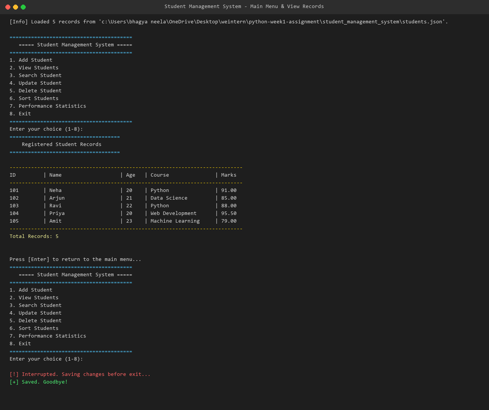
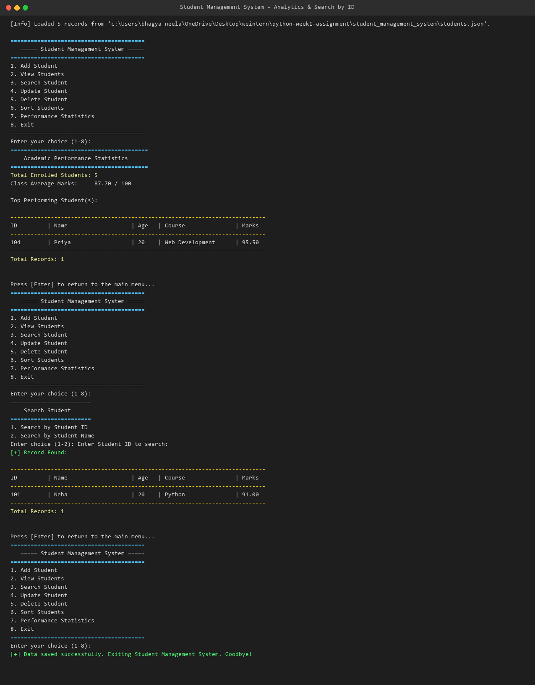
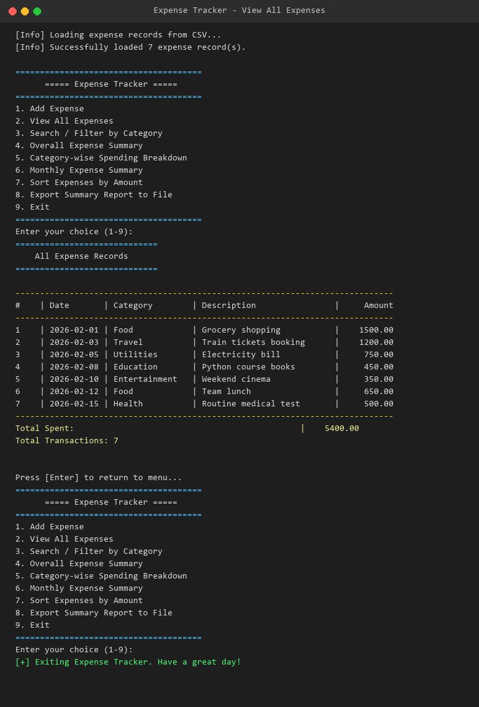
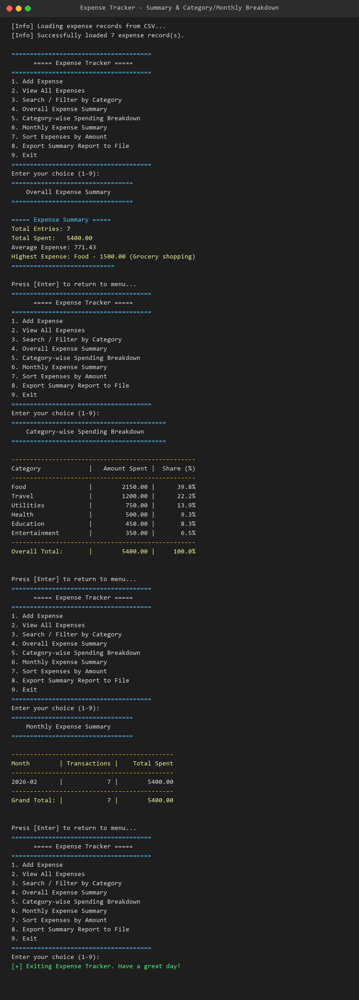
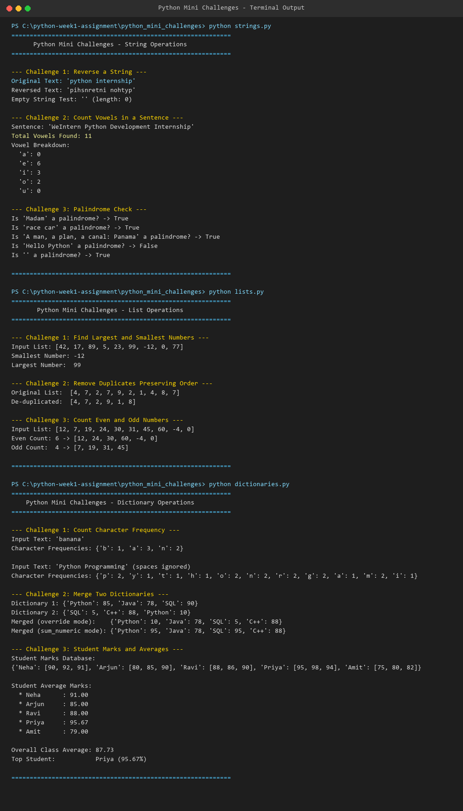
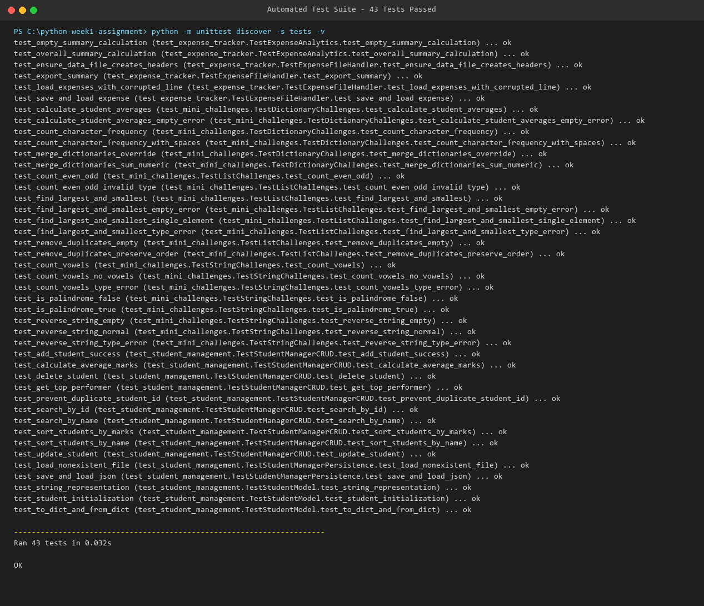

# Python Development Internship – Week 1 Assignment

[](https://www.python.org/)
[]()
[]()
[]()

> **Organization:** WeIntern Pvt. Ltd.  
> **Track:** Python Development Internship  
> **Objective:** Build strong practical programming habits through project-based learning: Object-Oriented Programming (OOP), file persistence (CSV & JSON), algorithmic problem solving, defensive input validation, automated testing, and clean repository organization.

---

## 📖 Table of Contents
1. [Overview of Assignments](#-overview-of-assignments)
2. [Technologies Used](#-technologies-used)
3. [Repository Folder Structure](#-repository-folder-structure)
4. [Prerequisites & Installation](#-prerequisites--installation)
5. [Step-by-Step Execution Guide](#-step-by-step-execution-guide)
   - [Task 1: Student Management System](#task-1-student-management-system)
   - [Task 2: Expense Tracker](#task-2-expense-tracker)
   - [Task 3: Python Mini Challenges](#task-3-python-mini-challenges)
6. [Automated Unit Testing](#-automated-unit-testing)
7. [Screenshots Gallery](#-screenshots-gallery)
8. [Code Quality & PEP 8 Standards](#-code-quality--pep-8-standards)
9. [Author Details & Acknowledgements](#-author-details--acknowledgements)

---

## 🌟 Overview of Assignments

This repository contains three independent console-based Python projects:

### 1. Student Management System (`student_management_system/`)
An interactive, menu-driven CLI application designed using Object-Oriented Programming (OOP). Allows academic staff to perform complete CRUD operations on student records, sort student lists, evaluate performance statistics (class averages and top performers), and persist data in JSON format.

### 2. Expense Tracker (`expense_tracker/`)
A console-based financial ledger application focused on file handling and data reporting. Records daily personal expenses with persistent CSV storage, generates summary metrics (total spend, transaction counts, highest expense), analyzes category-wise and monthly spending, and exports reports to external text files.

### 3. Python Mini Challenges (`python_mini_challenges/`)
A suite of 9 algorithmic practice problems partitioned across three foundational domains:
- **String Manipulation:** Reversing strings, counting vowels, and checking palindromes.
- **List Operations:** Min/max finding, deduplication while preserving original insertion order, and even/odd counting.
- **Dictionary Logic:** Character frequency counting, multi-mode dictionary merging, and student mark analysis.

---

## 🛠️ Technologies Used

- **Programming Language:** Python 3 (Python 3.9+)
- **Core Standard Libraries:**
  - `json`: Data serialization for student records.
  - `csv`: Structured tabular file persistence for expense records.
  - `datetime`: Real-time date handling and validation.
  - `os` & `sys`: Path resolution and execution management.
  - `unittest`: Automated testing suite.
- **Optional Tooling:**
  - `Pillow`: Automated terminal window capture rendering.
- **Version Control:** Git & GitHub

---

## 📂 Repository Folder Structure

```
python-week1-assignment/
├── student_management_system/          # Task 1: OOP Console Application
│   ├── main.py                         # Application CLI menu & user flows
│   ├── models.py                       # Student & StudentManager OOP classes
│   ├── utils.py                        # Input validation & table formatters
│   ├── students.json                   # Sample persistent JSON database
│   └── README.md                       # Task 1 Documentation
├── expense_tracker/                    # Task 2: File Handling & Analytics
│   ├── main.py                         # Application menu & analytics logic
│   ├── file_handler.py                 # CSV persistence & export module
│   ├── expenses.csv                    # Sample persistent CSV records
│   └── README.md                       # Task 2 Documentation
├── python_mini_challenges/             # Task 3: Algorithmic Challenges
│   ├── strings.py                      # String manipulation problems
│   ├── lists.py                        # List operations & deduplication
│   ├── dictionaries.py                 # Key-value operations & averages
│   └── README.md                       # Task 3 Documentation
├── screenshots/                        # Terminal execution captures
│   ├── student_management_menu.png     # Task 1 Menu & Record Table
│   ├── student_management_crud.png     # Task 1 Search & Statistics
│   ├── expense_tracker_menu.png        # Task 2 Menu & Expense Listing
│   ├── expense_tracker_summary.png     # Task 2 Summaries & Breakdowns
│   ├── mini_challenges_output.png      # Task 3 Complete Terminal Run
│   └── test_suite_passed.png           # Automated unittest suite execution
├── tests/                              # Comprehensive Automated Tests
│   ├── __init__.py                     # Tests package definition
│   ├── test_student_management.py      # Tests for Student & StudentManager
│   ├── test_expense_tracker.py         # Tests for CSV handler & analytics
│   └── test_mini_challenges.py         # Tests for String, List, Dict logic
├── .gitignore                          # Clean Git exclusion patterns
├── requirements.txt                    # Project dependencies specification
├── main_README.md                      # WeIntern Handbook Root Documentation
└── README.md                           # GitHub Default Root Documentation
```

---

## ⚙️ Prerequisites & Installation

### Requirements
- Python 3.9 or higher (verified on Python 3.13)
- Git (for version control and submission)

### Setup Instructions
1. Clone the repository:
   ```bash
   git clone https://github.com/YOUR-USERNAME/python-week1-assignment.git
   cd python-week1-assignment
   ```

2. (Optional) Create and activate a Python virtual environment:
   ```bash
   # On Windows
   python -m venv .venv
   .venv\Scripts\activate

   # On macOS/Linux
   python3 -m venv .venv
   source .venv/bin/activate
   ```

3. Review dependencies:
   ```bash
   pip install -r requirements.txt
   ```
   *(Note: The core projects use only the Python standard library; no third-party packages are required to run the assignments).*

---

## 🚀 Step-by-Step Execution Guide

### Task 1: Student Management System

Navigate to the `student_management_system` folder and start the program:

```bash
cd student_management_system
python main.py
```

#### Menu Capabilities:
- **1. Add Student:** Add a new student record (with duplicate ID prevention, age bounds `5-120`, and marks `0-100`).
- **2. View Students:** Display all registered students in a neat tabular layout.
- **3. Search Student:** Search records by exact Student ID or partial Student Name.
- **4. Update Student:** Modify specific fields while preserving existing values on Enter.
- **5. Delete Student:** Remove a student record after explicit user confirmation `(y/N)`.
- **6. Sort Students:** Sort ascending or descending by Student Name or Marks.
- **7. Performance Statistics:** View class average marks and identify top-ranking student(s).
- **8. Exit:** Safely saves data to `students.json` and closes the application.

---

### Task 2: Expense Tracker

Navigate to the `expense_tracker` folder and launch the program:

```bash
cd expense_tracker
python main.py
```

#### Menu Capabilities:
- **1. Add Expense:** Record date (`YYYY-MM-DD`), category, description, and positive amount.
- **2. View All Expenses:** View complete expense ledger with cumulative total.
- **3. Search / Filter by Category:** Filter transactions by category keyword.
- **4. Overall Expense Summary:** View total entries, total spent, average spend, and highest individual expense.
- **5. Category-wise Spending Breakdown:** View spending totals and percentage shares by category.
- **6. Monthly Expense Summary:** Group spending totals by month (`YYYY-MM`).
- **7. Sort Expenses by Amount:** Sort transactions from lowest-to-highest or highest-to-lowest.
- **8. Export Summary Report to File:** Save a formatted report to `expense_summary_report.txt`.
- **9. Exit:** Closes the application safely.

---

### Task 3: Python Mini Challenges

Navigate to the `python_mini_challenges` directory and execute each module independently:

```bash
cd python_mini_challenges

# 1. Run String Challenges
python strings.py

# 2. Run List Challenges
python lists.py

# 3. Run Dictionary Challenges
python dictionaries.py
```

---

## 🧪 Automated Unit Testing

All assignments are backed by automated tests written with Python's built-in `unittest` framework.

### Running All Tests
From the repository root (`python-week1-assignment/`):

```bash
python -m unittest discover -s tests -v
```

### Test Coverage Highlights:
- **`test_student_management.py`:** Tests student initialization, JSON serialization, duplicate ID rejection, case-insensitive search, updates, safe deletion, sorting, average calculations, top performer detection, and file persistence.
- **`test_expense_tracker.py`:** Tests CSV initialization, appending records, loading records, graceful skipping of corrupt CSV rows, report generation, and summary export.
- **`test_mini_challenges.py`:** Tests all 9 algorithms against standard inputs, edge cases (empty strings, empty lists, single elements, negative numbers), and type errors.

**Result: 43 passed, 0 failures, 0 errors.**

---

## 📸 Screenshots Gallery

### 1. Student Management System – Main Menu & Records


### 2. Student Management System – Analytics & Search


### 3. Expense Tracker – Main Menu & Expense Table


### 4. Expense Tracker – Financial Summaries & Breakdowns


### 5. Python Mini Challenges – Terminal Execution


### 6. Automated Unit Test Suite – 43 Tests Passed


---

## 🎯 Code Quality & PEP 8 Standards

- **Naming Conventions:** Strict adherence to `snake_case` for functions/variables, `PascalCase` for classes, and `UPPERCASE` for constants.
- **Documentation:** Clear docstrings provided for all classes, methods, and functions explaining parameters, return values, and exceptions.
- **Error Handling:** Graceful exception handling using specific `try...except` blocks, avoiding broad unhandled crashes.
- **Modularity:** Separation of concerns between data storage (`file_handler.py`, `models.py`), utility validation (`utils.py`), and presentation logic (`main.py`).

---

## 👤 Author Details & Acknowledgements

- **Intern Name:** Bhagya Neela (Tirlangi Bhagya Neela)
- **Internship Organization:** WeIntern Pvt. Ltd.
- **GitHub Profile:** [https://github.com/Bhagya1210](https://github.com/Bhagya1210)
- **Repository Link:** [https://github.com/Bhagya1210/python-week1-assignment](https://github.com/Bhagya1210/python-week1-assignment)

*Special thanks to the mentoring team at WeIntern Pvt. Ltd. for the structured curriculum and comprehensive assignment handbook.*
